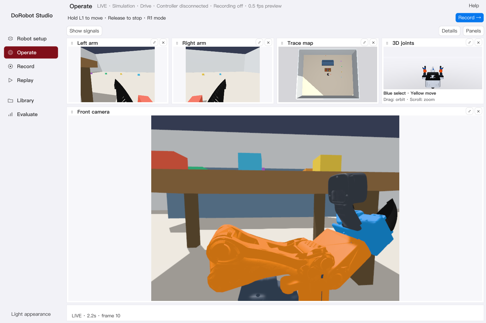
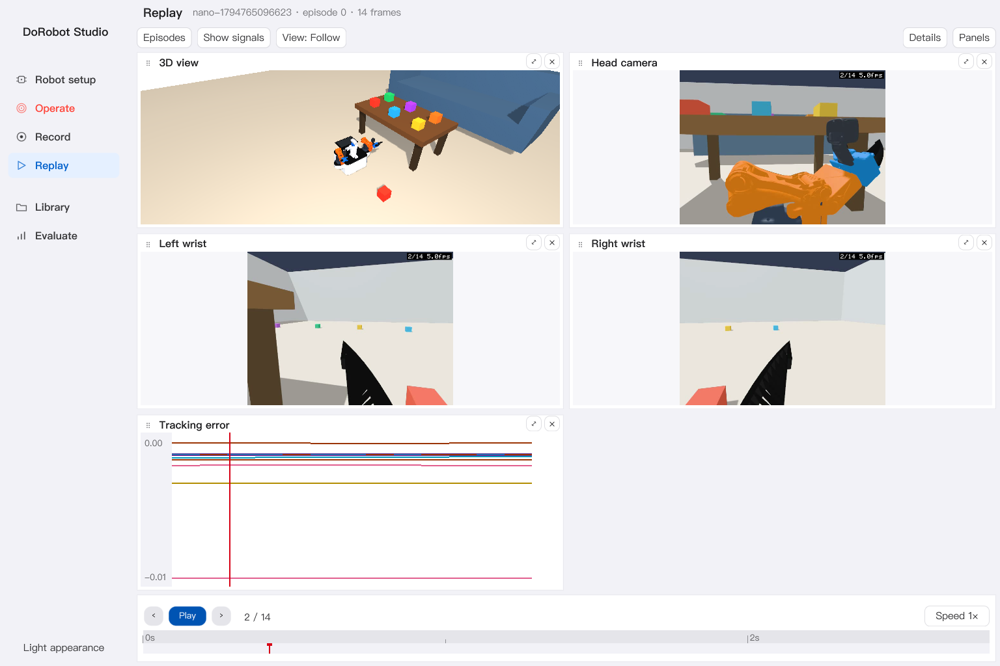

# DoRobot Studio user guide

For **v0.1.0-rc.2**, the standalone macOS Apple Silicon release with the native
Rust runtime. UI labels below match this release. Start with the simulation
walkthrough if you want to try Studio without connecting a robot.

[Download RC.2](https://github.com/dorobot-org/dorobot-studio/releases/tag/v0.1.0-rc.2)
· [Release validation](NATIVE_RUNTIME_ACCEPTANCE.md)
· [Build and JIT instructions](../tools/release/README.md)

## Contents

1. [Choose your workflow](#1-choose-your-workflow)
2. [Install and open Studio](#2-install-and-open-studio)
3. [First simulation and recording](#3-first-simulation-and-recording)
4. [Find your way around](#4-find-your-way-around)
5. [Connect and use a controller](#5-connect-and-use-a-controller)
6. [Arrange cameras and inspect joints](#6-arrange-cameras-and-inspect-joints)
7. [Record simulation data](#7-record-simulation-data)
8. [Replay and review datasets](#8-replay-and-review-datasets)
9. [Connect a real Adora Nano base](#9-connect-a-real-adora-nano-base)
10. [Set up and calibrate SO-100/101 arms](#10-set-up-and-calibrate-so-100101-arms)
11. [Record with real arms and cameras](#11-record-with-real-arms-and-cameras)
12. [Download and upload datasets](#12-download-and-upload-datasets)
13. [Connect an external live stream](#13-connect-an-external-live-stream)
14. [Files, backups and recovery](#14-files-backups-and-recovery)
15. [Keyboard shortcuts](#15-keyboard-shortcuts)
16. [Troubleshooting](#16-troubleshooting)
17. [JIT development and current limits](#17-jit-development-and-current-limits)

## 1. Choose your workflow

| Your goal | Start here | What RC.2 supports |
|---|---|---|
| Drive Nano in a room and capture a dataset | Robot setup → Simulation | GPU physics, base, both arms, head, three cameras and recording |
| Check Nano wheel commands without a robot | Robot setup → Real robot → Adora Nano → Bus test | Mock serial bus, wheel commands and acknowledgements; no room simulation |
| Drive a physical Nano base | Robot setup → Real robot → Adora Nano → Connect | Feetech wheel motors only; no physical arm/head control, odometry or Nano camera capture |
| Collect demonstrations from physical SO-100/101 arms | Robot setup → Real robot → SO-100 / SO-101 | Leader/follower calibration, teleoperation and camera recording |
| Inspect existing recordings | Library → Open folder… | LeRobot v2/v3 review, synchronized video and available joint/scene data |
| Watch another producer | Robot setup → More → External stream… | A compatible local Unix-socket preview stream |

**Simulation calibration:** joint zeros, limits and camera mounts come from the
bundled model. There is no servo-calibration step. Stop and restart simulation
to reset the room and robot.

**Physical calibration:** SO-100/101 needs calibration of the actual leader and
follower. The Nano base adapter has no arm/head calibration workflow. A successful
Bus test checks software commands, not the direction or mechanics of real wheels.

## 2. Install and open Studio

### Requirements

- A Mac with Apple Silicon and macOS 14 or later.
- Space for the application and your recordings. Raw three-camera sensor data
  takes more space than the MP4 previews alone.
- A PS4 DUALSHOCK 4 or PS5 DualSense controller for manual Nano control. You can
  start simulation, view cameras and record without a controller.
- For physical capture: the appropriate robot, serial connections and cameras.

The standalone application includes Dora, Nexus, Nano models and video libraries.
It does not require Rust, Python, uv, Homebrew or a separate AISLE checkout.
Internet access is needed to download the release and for Hub transfers; the
built-in simulation and local replay can run offline.

### Installation

1. Download `DoRobot-Studio-v0.1.0-rc.2-macos-arm64.zip` from the release page.
   The `jit-source.tar.gz` asset is for development, not normal installation.
2. Extract the ZIP and move **DoRobot Studio.app** to **Applications**.
3. Open the application. RC.2 is ad-hoc signed and is not Apple-notarized.
4. If macOS blocks it because the developer cannot be verified, first confirm
   that you downloaded the intended release. After attempting to open it, use
   **System Settings → Privacy & Security → Open Anyway** if available, then
   confirm the application. See [Apple's instructions](https://support.apple.com/en-us/102445).
   A damaged-file warning should prompt a fresh download and checksum check.

For an optional integrity check, download `SHA256SUMS.txt` beside the ZIP, open
Terminal in that download folder, and run:

```sh
shasum -a 256 DoRobot-Studio-v0.1.0-rc.2-macos-arm64.zip
```

Compare the result with the ZIP's entry in `SHA256SUMS.txt`.

## 3. First simulation and recording

1. Open **Robot setup**, select **Simulation**, then **Start simulation**.
2. Wait for physics and cameras to initialize. The first launch prepares GPU
   shaders. Studio opens **Operate** when ready; **Open controls** returns there.
3. Look for the front camera, two wrist cameras, trace map and **3D joints** view.
   The live frame counter should advance even without controller input.
4. If using a controller, release L1, center both sticks and release the D-pad
   and face buttons. Then hold **L1** and gently push the left stick forward.
   Release L1 to stop commanding motion.
5. Open **Record**, or click **Record →** from Operate. Enter a task, such as
   `Approach the table and inspect a cube`. Use **Choose…** to select a save folder.
6. Click **● Record**. Move the robot or leave it observing the scene. Confirm
   the captured frame count increases.
7. Click **■ Stop recording**. Wait for the take to become ready for review.
8. Click **Save episode**, wait for saving to finish, then **Replay →**.
9. Press **Play**. Check the three videos, robot pose and joint signals. A take
   captured without movement will naturally have nearly constant joint traces.
10. When finished, return to **Robot setup** and click **Stop**. Save or discard
    any pending take first.

This walkthrough creates one LeRobot dataset per saved simulation take. The
default save parent is `~/DoRobot/Recordings`; Studio creates a `nano-…` directory
inside it. Choose folders through the picker, or enter a full absolute path;
text fields do not expand shell abbreviations such as `~`.

## 4. Find your way around

| Page | Use it for |
|---|---|
| **Robot setup** | Choose simulation or hardware, start/stop simulation, configure a rig, calibrate, or connect the Nano base |
| **Operate** | Watch a live source, drive Nano, switch camera views and inspect selected joints |
| **Record** | Name a task, capture a take, stop, save, discard or open the saved replay |
| **Replay** | Play a saved episode, scrub time, inspect signals, tag or exclude episodes |
| **Library** | Open dataset folders, browse datasets, start a new recording or pull from Hub |
| **Evaluate** | Evaluation display; RC.2's production backend does not include a connected policy runner |

**Help** reveals guidance for the current workflow. **More** reveals setup
diagnostics and the external-stream entry. **Details**, **Show signals** and
**Panels** control the Replay/Operate workspace.

Changing pages does not stop a simulation or its recording. A pending recording
or unsaved take displays a **Go to Record** banner. Real Nano base control has a
different lifetime: leaving Robot setup/Operate stops its driver. Restoring a
previous app session never automatically connects hardware or starts playback.

## 5. Connect and use a controller

### Pair with macOS

1. Turn the controller off and disconnect its USB cable before Bluetooth pairing.
2. For PS4, hold **SHARE + PS** until the light flashes. For PS5, hold
   **Create + PS** until the light flashes.
3. Open macOS **System Settings → Bluetooth**, select the controller and connect.
   A compatible USB data cable is also an option.
4. In Studio, start simulation or connect the Nano base and open **Operate**.
   Check the controller status. RC.2 selects the first connected controller;
   disconnect other gamepads if the wrong one is being read.

Pairing references: [DUALSHOCK 4](https://www.playstation.com/en-gb/support/hardware/ps4-pair-dualshock-4-wireless-with-pc-or-mac/)
and [DualSense](https://www.playstation.com/en-gb/support/hardware/pair-dualsense-controller-bluetooth/).

### Enable movement and change modes

| Control | Result |
|---|---|
| **Hold L1** | Enable motion commands in the current mode |
| **Release L1** | Stop sending motion commands |
| **R1** | Simulation only: cycle Drive → Left arm → Right arm → Head → Drive |
| **Options** | Pause/resume controller commands; this does not pause physics or recording |

**L1 and R1 are the upper shoulder buttons**, not L2/R2. L1 is a hold-to-enable
control so a released controller does not keep commanding movement. In physics,
inertia and contact can still affect the robot after a command stops.

After connecting, changing modes, resuming, or recovering from a timeout:
release L1, center both sticks, release D-pad/face buttons, then hold L1 again.
Holding L1 throughout a mode change intentionally leaves movement disabled.

### Simulated Nano: Drive

| While holding L1 | Action |
|---|---|
| Left stick up/down | Forward/reverse |
| Right stick left/right | Turn |
| D-pad up/down | Forward/reverse when the left stick is vertically centered |
| D-pad left/right | Turn when the right stick is horizontally centered |

RC.2's simulation gamepad mapping does **not** assign lateral strafing to the
left stick. The physical Feetech base mapping below does support strafing.

### Simulated Nano: Left arm or Right arm

Press R1 until the desired arm appears in the status, then rearm L1. Both arms
have the same six named controls; their motions follow each joint's local axis.

| While holding L1 | Joint |
|---|---|
| Left stick left/right | J1 — shoulder yaw |
| Left stick up/down | J2 — shoulder pitch |
| Right stick up/down | J3 — elbow pitch |
| Right stick left/right | J4 — wrist pitch |
| D-pad left/right | **J5 — wrist roll** |
| Cross **×** | J6 — open gripper |
| Circle **○** | J6 — close gripper |

These are joint controls, not Cartesian hand-position controls. A single stick
does not automatically move the gripper in a straight line or solve a grasp.
For picking practice, approach in Drive, switch to an arm, promote its wrist
camera, and adjust one joint at a time. Physics contacts and joint limits can
restrict motion. Recording a grasp attempt does not certify that it succeeded.

### Simulated Nano: Head

| While holding L1 | Action |
|---|---|
| Left stick left/right | Head pan |
| Left stick up/down | Head tilt |

### Physical Nano base and Bus test

| While holding L1 | Action |
|---|---|
| Left stick up/down | Forward/reverse |
| Left stick left/right | Strafe |
| Right stick left/right | Turn |

Only Drive is available here; R1 does not enable arms or head. Wheel readouts
are commanded vendor ticks, not measured velocity or position. Release L1 to
request zero speed and torque-off. **Disconnect** stops the driver.

## 6. Arrange cameras and inspect joints



*RC.2 simulation acceptance capture. The displayed preview rate is a live
measurement, not a guaranteed rate or benchmark.*

The default Operate layout puts the front camera in the main area and small
views in a row above it. Click **inside a small camera image**, below its title
bar, to make it the main view. Click the front-camera thumbnail to restore it.
The title bar remains available for dragging. The joint model stays interactive
so dragging it orbits the model instead of promoting it.

| Workspace action | How |
|---|---|
| Rearrange panels | Drag a panel title |
| Change panel sizes | Drag a divider |
| Maximize a view | Click the expand icon in its title bar |
| Restore the grid | Click restore, or press Escape |
| Close a panel | Click its title-bar × |
| Reopen a closed panel | **Panels**, then select the view |
| Recover the arrangement | **Panels → Reset layout**; hardware inspection also offers **More → Restore panels** |
| Open another replay window | **Replay → Panels → Replay window** |

Replay windows share the selected episode and playhead, but have independent
layouts. Operate and Replay also retain separate layouts and playback state.

In **3D joints**, blue marks the selected control group and yellow marks joints
receiving motion commands. Drag to orbit and scroll to zoom. A **Near limit**
message identifies constrained joints and suggests the opposite control. Joint
highlights describe control selection/activity; measured pose shows what physics
actually did. They do not prove physical robot feedback is available.

## 7. Record simulation data

### Take lifecycle

| State | What to do |
|---|---|
| Ready | Enter Task and Save folder; click **● Record** |
| Recording | Operate the robot; click **■ Stop recording** to finish |
| Finalizing | Wait while the recorder completes all sensor frames |
| Review / unsaved take | **Save episode** to keep it, or **Discard take** to remove it |
| Saved | **Replay →**, or record another take |

You cannot shut down simulation while a take is pending. Returning to Robot
setup or Library preserves the take. **Discard take** removes the current
unsaved take and leaves previously saved datasets intact. Save before quitting;
an unsaved simulation take is not a durable, automatically restored dataset.

### What is captured

| Data | Saved representation |
|---|---|
| Head, left wrist and right wrist RGB | Three MP4 videos, plus lossless RGB arrays in raw samples |
| Depth and segmentation | Raw arrays for all three cameras |
| Camera pose and calibration | Per-frame transforms and nominal simulation intrinsics/mount information |
| Robot state | 17 measured joint channels: 3 wheels, 6 joints per arm, 2 head joints |
| Control | Targets and command data, including raw control records |
| Scene | Base pose, object transforms and contact samples |
| Timing and audit | Simulation/source clocks and raw-file SHA-256 checksums |

Cameras are sampled at **640 × 480, 5 frames per simulation second**. All three
belong to the same sensor sample. Live preview is a separate, latest-frame feed:
it may skip displayed frames while the recorder preserves the complete take.
Studio reports the observed preview rate separately. Five simulation seconds
can take longer than five wall-clock seconds; this release does not promise
30 FPS real-time streaming.

Depth, segmentation and camera transforms are saved for analysis, but the camera
panels show RGB. A successful save means data capture succeeded. Manual takes
leave task success unevaluated; they are not automatically scored cube pickups.

## 8. Replay and review datasets

### Open and play

1. Go to **Library → Open folder…**.
2. Choose a dataset containing `meta/info.json`, or a parent folder containing
   datasets. Open a dataset card to enter Replay.
3. Click **Episodes** to reveal the episode list and select an episode.
4. Use **Play**, the previous/next-frame buttons, or drag the timeline.
5. **Speed** cycles through 0.25×, 0.5×, 1× and 2×.
6. Use **Show signals** for channels, **Details** for episode information and
   **Panels** for layout controls. If available, **View: Follow** switches the
   scene-view mode.



*A saved take can play while a separate live simulation is still running.*

Playback changes only the recorded view; it does not send motor commands.
Stepping pauses playback. Pressing Play at the end starts again from the beginning.
Available camera names and 3D content depend on the dataset. A third-party
dataset without a compatible robot model or video should show missing-content
guidance rather than fabricated camera or robot data.

### Curate episodes

In **Replay → Details**:

- **Tag good** and **Tag bad** save a review label. Click the same tag again to
  clear it.
- **Exclude episode** hides an episode from Studio review while preserving its
  original files. Press **Cmd-Z** on macOS to undo the latest exclusion.
- **Push to Hub** opens the upload form for the current dataset.

Tags and exclusions survive restart. Exclusion is a curation sidecar, not a
rewrite of Parquet or video files. Hub upload includes the original data and
sidecars. Downstream training must explicitly apply exclusions if unwanted
episodes should be omitted.

## 9. Connect a real Adora Nano base

The supplied driver supports three Feetech wheel motors: IDs **13, 14 and 15**
at **1,000,000 baud**. Physical direction and motor configuration still need
device validation. Use the robot's hardware stop provision for failures that
prevent the computer from sending a stop command, such as lost power or USB.

### Check the software with Bus test

1. Open **Robot setup → Real robot → Adora Nano**.
2. Click **Bus test**, then **Open controls**.
3. Release L1 and center sticks, then hold L1 and try forward, strafe and turn.
4. Open **More** to inspect commanded wheel ticks and acknowledged writes.
5. Release L1 and check that commands return to zero. Click **Disconnect**.

The model intentionally stays in a reference pose during this test: there is
no physics scene or measured odometry behind a mock serial bus.

### Connect the robot

1. Connect the base's USB serial interface.
2. Enter its actual `/dev/…` device in the serial field. **Find port** cycles
   detected USB candidates; selecting one does not connect automatically.
3. Click **Connect**, check the status, then **Open controls**.
4. Rearm L1 and try a small command. Verify the physical wheel directions before
   relying on forward/strafe/turn labels.
5. Release L1 to stop commands. Click **Disconnect** when finished.

Leaving Robot setup/Operate or connecting another external source stops this
driver. A stopped or faulted connection requires an explicit reconnect. A stop
acknowledgement failure is reported as a fault, not a confirmed stop.

Real Nano arms, head, camera capture, measured joint pose and odometry are
unavailable with this adapter. Simulation capabilities do not imply the same
hardware capabilities. See the [Nano driver guide](../robots/adora_nano_feetech/README.md)
for the protocol and watchdog behavior.

## 10. Set up and calibrate SO-100/101 arms

This is the physical leader/follower workflow. RC.2 implements it in Rust, but
the release's acceptance did not include physical arms or cameras. Use your
rig's operating procedure and verify it on the actual devices.

### Create or load a rig

1. Open **Robot setup → Real robot → SO-100 / SO-101**.
2. Set **Type** to `so100` or `so101`.
3. Enter distinct **Follower** and **Leader** serial ports.
4. Enter camera indexes separated by commas, such as `0,1`. Numeric indexes use
   macOS AVFoundation. Each camera must be a different device.
5. Enter **Task** and choose an absolute **Save folder**.
6. Click **Use this rig**. Use **Edit rig** to change it later, or **Load profile…**
   to select an existing JSON profile.

The worker expects STS3215 motors at IDs 1–6, 1,000,000 baud. Rig creation does
not provision motor IDs or baud rates. It saves configuration without connecting
the motors. Hardware opens when calibration or capture starts.

The form defaults to 30 requested capture FPS, a 300-second episode limit and
an episode target of 50. Actual capture throughput depends on hardware. Advanced
settings and stable leader/follower calibration IDs are available in the JSON
[example profile](../tools/capture/rig.example.json). Replace every example port
and path with your own values. Relative dataset paths resolve from the profile's
folder. String camera sources are media paths; for a live macOS camera, prefer
its numeric AVFoundation index.

### Calibrate the actual joints

1. Click **Start calibration**. Read the live calibration prompt before moving
   anything or pressing Continue.
2. The **leader** is first. With torque off, place it in its middle position,
   then click **Continue** when requested.
3. At the range prompt, gently move each joint through its available range,
   including the gripper. Follow the wrist-roll instruction. Then click
   **Continue** to save those ranges.
4. Repeat the prompted middle-position and range steps for the **follower**.
5. Wait for **Calibration complete** before opening Record.

The process writes homing offsets and ranges to the motors and saves matching
calibration files. A joint that barely moved, an encoder wrap or an invalid ACK
causes an error. Follow the error and repeat the affected setup; do not force
a joint against a mechanical stop. **Restart step** cancels the current
calibration attempt and lets you begin again. **Calibrate again** repeats it
after a completed calibration.

Capture checks that the saved calibration agrees with the actual motor
registers. Replacing an arm, changing profile IDs or changing motor settings can
invalidate it. The current UI also requires calibration completion in the active
session before recording; a restored profile alone does not enable capture.

## 11. Record with real arms and cameras

1. Complete calibration, then open **Record**.
2. Click **Record**. This starts leader-to-follower control and recording
   together; the gamepad arm mapping belongs to Nano simulation, not this rig.
3. Check camera previews and measured joint readings. Grant macOS camera access
   if requested. Move the leader to demonstrate the task on the follower.
4. Click **Stop** and wait for the completed take.
5. Choose **Save episode**, **Discard last**, or **Re-record**.
6. After saving, use **Replay →** to inspect the result.

Every declared camera must produce video for saving to succeed. State, the
limited action actually sent to the follower, timestamps and camera statistics
are recorded. SO joint values follow LeRobot's normalized units: most joints
use −100 to +100 and the gripper uses 0 to 100; they are not Nano joint radians.

Compatible takes append to the rig's LeRobot v2.1 dataset. Changing cameras,
robot type or FPS can make an existing destination incompatible; use a new
dataset folder for a different configuration. Stopping/completing capture closes
its cameras and motor connections. A 30 FPS request is not a measured-rate
guarantee.

## 12. Download and upload datasets

### Pull from Hub

1. Open **Library → Pull from Hub**.
2. Enter a dataset repository as `owner/name`, not a webpage URL.
3. Click **Transfer** and choose a **download parent folder**.
4. Studio creates a child directory named after the dataset. That destination
   must be absent or empty. Wait for **Hub transfer completed**.
5. Open the downloaded dataset from Library.

Downloads become visible at the destination only after completion. Failed
transfers report an error; retry after resolving access or connection issues.

### Push to Hub

1. Open the saved dataset in Replay.
2. Open **Details → Push to Hub**.
3. Enter `owner/name` and click **Transfer**.
4. Wait for completion and review the destination repository.

Uploads send the dataset, including curation sidecars. Newly created Hub
repositories are private. An existing repository keeps its existing visibility.

Studio has no account-login form. The native worker reads `HF_TOKEN`, or the
normal token file at `~/.cache/huggingface/token`; `HF_HOME` and `HF_TOKEN_PATH`
can select another store. Authenticate with your existing Hub setup before
launching Studio. A Finder launch does not automatically inherit variables set
only in a Terminal shell. Public downloads may work without a token; restricted
downloads and uploads require the appropriate account access. Keep tokens out
of rig profiles, datasets and screenshots. Authenticated upload was not part
of RC.2's acceptance run.

## 13. Connect an external live stream

1. Start a compatible producer separately and obtain its local socket path.
2. Go to **Robot setup → More → External stream…**.
3. Enter the path, such as `/tmp/nano-living.sock`, and click **Connect**.
4. Check the live frame counter, camera list, connection state and preview rate.
5. Use **Disconnect** to detach the viewer. **Open recording** becomes available
   when the producer exposes a finalized dataset.

The endpoint must implement Studio's preview protocol; it is not an arbitrary
IP address, RTSP URL or USB-camera selector. The viewer reports stale input and
retries the connection. Detaching the external viewer does not stop the
producer's recording. External producers own their recording/control lifecycle;
Studio's built-in simulation Record buttons manage the simulation Studio started.

A physical Nano can appear here only through a producer that supplies its real
camera/state data in the compatible format. The bundled Feetech base adapter
does not supply those cameras. Developer details are in the
[native runtime guide](../runtime/README.md).

## 14. Files, backups and recovery

### Where data lives in the standalone app

| Item | Default location |
|---|---|
| Saved simulation datasets | `~/DoRobot/Recordings/nano-…/` |
| Real rig dataset | The Save folder in that rig profile |
| App preferences, layouts and generated rig profiles | `~/Library/Application Support/DoRobot Studio/` |
| Simulation session diagnostics | `~/Library/Application Support/DoRobot Studio/runs/studio-…/` |
| SO calibration | `~/.cache/huggingface/lerobot/calibration/` |
| Temporary real-capture files | A `dorobot-capture-…` directory in the system temporary directory |

The application bundle is read-only at runtime. Updating or moving the `.app`
does not move your recordings. Back up whole dataset directories, rig profiles
and calibration files. Save/stop before replacing the application.

A saved simulation dataset includes:

```text
nano-…/
├── meta/
│   ├── info.json
│   ├── episodes.jsonl
│   ├── tasks.jsonl
│   ├── capture.json
│   ├── capture-result.json
│   └── scene/episode_000000.json
├── data/chunk-000/episode_000000.parquet
├── videos/chunk-000/
│   ├── observation.images.head/episode_000000.mp4
│   ├── observation.images.left_wrist/episode_000000.mp4
│   └── observation.images.right_wrist/episode_000000.mp4
└── raw/
    ├── frames.jsonl
    ├── control.parquet
    └── frame_000000.npz …
```

An MP4 by itself is not the full dataset. Preserve `raw/` for lossless sensors,
depth, segmentation and camera poses. Preserve `meta/scene/` for scene replay.
Real SO recordings use their configured camera names and do not acquire the
simulation-only depth/segmentation/scene fields.

### Recover after interruption

- **Saved dataset:** reopen its folder from Library. UI preferences can restore
  the last dataset, episode, layout and playhead; playback starts paused.
- **Completed unsaved SO take:** load the same rig profile. Studio can restore
  the pending-take sidecar if its temporary capture files still exist. Save it
  promptly; temporary files are not a backup.
- **Interrupted simulation or failed save:** keep the session folder and read
  the error. Captured files may be retained for diagnosis, but the UI does not
  promise automatic recovery of an unfinished simulation take.
- **Existing dataset writer error:** avoid another concurrent writer. The SO
  writer uses a lock and a commit journal; preserve the folder when investigating
  a failed commit instead of manually deleting individual metadata files.

Local rig files and logs can contain serial-device paths and local filenames.
Share only the relevant, redacted diagnostics when reporting a problem.

## 15. Keyboard shortcuts

| Shortcut | Action |
|---|---|
| Cmd/Ctrl-1 | Robot setup |
| Cmd/Ctrl-2 | Operate |
| Cmd/Ctrl-3 | Record |
| Cmd/Ctrl-4 | Replay |
| Cmd/Ctrl-5 | Library |
| Cmd/Ctrl-6 | Evaluate |
| Space, in Replay | Play/pause when a focused control is not consuming Space |
| Left/Right arrows, in Replay | Step one frame and pause |
| Home/End, in Replay | Jump to beginning/end |
| Cmd/Ctrl-Z, in Replay | Undo the latest exclusion |
| Escape | Close the Hub form or restore a maximized panel, depending on focus |

On compact Mac keyboards, Fn-Left/Fn-Right can provide Home/End. The sidebar and
transport buttons provide the same primary navigation/playback actions.

## 16. Troubleshooting

| Symptom | Check and recovery |
|---|---|
| First simulation launch is slow | Allow shader initialization to finish. Read the setup status; if it fails, inspect that session's `dora.log` before retrying. |
| No movement while holding L1 | Confirm a controller is connected, Options has not paused control, and the expected mode is selected. Release L1, center sticks/release other controls, then hold L1 again. |
| Movement stops after R1 | Mode changes require neutral rearm. Release L1 and center/release controls before holding it again. |
| Left arm J5 seems inaccessible | Select Left arm and use **L1 + D-pad left/right**. J5 is not on a stick. Check the selected joint highlights. |
| A joint stops at an extreme | Check **Near limit**, reverse the indicated control, and inspect contacts in 3D. Joint targets are bounded; physical collisions may also stop motion. |
| Left stick does not strafe in simulation | RC.2 simulation maps forward/reverse and turning only. Strafing is available in the physical base/Bus test mapping. |
| Bus test model stays still | Expected: it tests serial commands and ACKs. Choose **Simulation → Start simulation** for a moving physics model. |
| Live picture is static | Check frame count and connection/stale status. A stationary camera can show an unchanged image while frames advance. Confirm you are in Operate rather than paused Replay. |
| Preview is slower than recording FPS | Preview throughput is measured in wall time; the simulation dataset uses 5 Hz simulation time. Preview can drop display frames independently. |
| A camera or panel vanished | **Panels** → reopen it, or **Reset layout**. Reset Operate and Replay independently. |
| Record is disabled | Simulation must be ready with no pending take. SO capture requires a valid rig and completed calibration. Physical Nano base has no camera-recording workflow. |
| Stop simulation is disabled | Stop recording, then save or discard the pending take. |
| Save folder is rejected | Use **Choose…** or an absolute writable path. A literal `~` is not expanded in a text field. |
| Missing/incorrect serial port | Check the cable and actual device path. Use **Find port** for Nano. Verify distinct leader/follower ports for SO rigs. |
| Calibration mismatch or insufficient joint range | Recalibrate the actual leader and follower with the intended profile IDs, following each prompt. |
| Real camera fails to open | Check macOS camera permission, device index and whether another application owns it. The native numeric-camera path requests 640 × 480 at the rig's FPS. |
| Saved replay has constant signals | Verify you recorded actual movement, selected the intended episode and pressed Play. Camera motion and joint motion are different measurements. |
| Hub rejects a destination | Pull chooses a parent folder; its `dataset-name` child must be empty or absent. |
| Hub reports HTTP 401/403 | Check the token store and access to the named dataset; a Terminal-only environment variable may not reach a Finder-launched app. |
| Native runtime cannot start | Use the complete RC.2 `.app`, not a copied UI executable. In development, select the installed app or build the runtime as documented below. |
| Evaluate shows No checkpoint / Not driving | Expected without a policy runner. The production RC does not include autonomous rollout execution. |

For a reproducible issue, record the release version, selected workflow, exact
steps and visible error. Simulation session diagnostics include `dora.log`,
`startup.json`, `progress.json`, `controller.json`, `command.json` and
`recording-status.json` as those stages become available. Logs are not a substitute
for a saved dataset. Do not include account tokens or private device information.

## 17. JIT development and current limits

Normal users can use the standalone app. Developers can use the matching source
archive and retain Makepad JIT while reusing the installed native runtime:

```sh
# Run from the extracted source directory.
DOROBOT_APP='/Applications/DoRobot Studio.app' \
  tools/release/run_jit_macos.sh --video

DOROBOT_APP='/Applications/DoRobot Studio.app' \
  tools/release/run_jit_macos.sh --check --video
```

Development requires Rust/Cargo, Git, Python 3 for the launcher, Xcode Command
Line Tools and pkg-config. Edit UI Rust/Splash through the JIT workflow; native
runtime changes require rebuilding that runtime. See [JIT details](JIT.md),
[runtime build instructions](../runtime/README.md) and
[release packaging](../tools/release/README.md).

The shipped application logic and runtime nodes are Rust. FFmpeg supplies native
video codecs and macOS supplies Metal/AVFoundation. Build and acceptance tooling
may use Python outside the app; the application neither packages nor launches it.

RC.2 acceptance covered native GPU simulation, all 17 moving joints, all three
cameras, recording/replay, mock-base stop behavior and 16 relocated-app workflows
with Python execution blocked. Physical robots, real camera capture and
authenticated Hub upload still need device/account validation. Camera calibration
is nominal in simulation, furniture is rigid, and manual recording does not
establish autonomous navigation or grasp success. Full results are in
[native runtime acceptance](NATIVE_RUNTIME_ACCEPTANCE.md).
